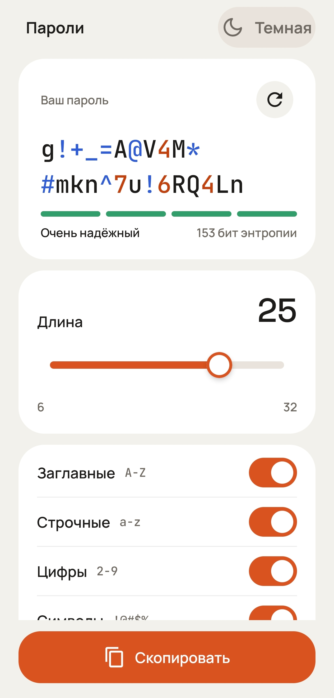
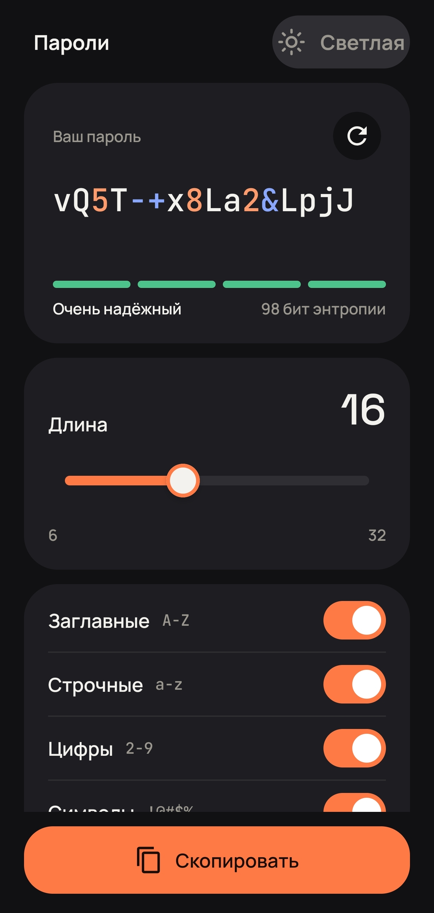

# 🔐 Генератор паролей

Простое Android-приложение для создания надёжных паролей.
Написано на Kotlin и Jetpack Compose.

## Скриншоты

| Светлая тема | Тёмная тема |
|---|---|
|  |  |

## Возможности

- Длина пароля от 6 до 32 символов
- Выбор наборов символов: заглавные, строчные, цифры, спецсимволы
- В пароле всегда есть хотя бы один символ каждого выбранного типа
- Без похожих символов (0/O, 1/l/I) — пароль легко перепечатать
- Оценка надёжности в битах энтропии и шкала из 4 уровней
- Цифры и спецсимволы подсвечены разными цветами
- Копирование в буфер обмена (на Android 13+ пароль скрыт в превью)
- Светлая и тёмная тема с переключателем

## Технологии

- **Kotlin**
- **Jetpack Compose** + Material 3
- **ViewModel** + **StateFlow**
- **Coroutines**
- `SecureRandom` для криптостойкой генерации

## Архитектура

Однонаправленный поток данных (UDF):

```
UI ──Command──▶ ViewModel ──▶ StateFlow<State> ──▶ UI
```


## Скачать

Готовый APK — в разделе [Releases](../../releases).

## Сборка

1. Клонировать репозиторий
2. Открыть в Android Studio
3. **Run ▶**

Минимальная версия Android: 9.0 (API 28).